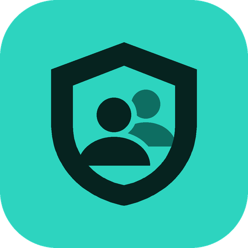

# ACL-Hero

**Kto naprawdę ma dostęp do Twoich folderów sieciowych? ACL-Hero pokaże to w kilka sekund i pozwoli bezpiecznie to zmienić.**

Darmowe narzędzie dla administratorów Windows i Active Directory: raporty uprawnień NTFS i udziałów, edycja uprawnień, zarządzanie grupami AD. Każda zmiana ma podgląd, kopię sprzed zmiany i przycisk „Cofnij”.

### [⬇️ Pobierz ACL-Hero](https://github.com/mayaa79/ACL-Hero/releases/latest)

Pobierz plik `ACL-Hero-Setup-<wersja>.exe` i uruchom go na serwerze albo stacji administratora. Instalator zawiera środowisko .NET, więc nic więcej nie trzeba doinstalowywać.

## Dla kogo

Dla administratora, który słyszy: „kto ma dostęp do folderu Księgowość?”, „dlaczego Kowalski nie może otworzyć udziału?”, „zabierz uprawnienia osobie, która odeszła”. Zamiast klikać we właściwościach każdego folderu osobno, dostajesz pełny obraz w jednej tabeli, z eksportem do Excela lub PDF.

## Co potrafi

**🌳 Drzewo serwerów**
Ten komputer i dowolne serwery plików w jednym widoku: dyski i foldery (zdalnie przez `C$`, `E$`) oraz udziały sieciowe. Lista serwerów jest zapamiętywana.

**📊 Raport ACL** (tylko odczyt, niczego nie zmienia)
- *Podstawowy*: kto ma jakie uprawnienia, z kolumną uprawnień efektywnych.
- *Zaawansowany*: uprawnienia po rozwinięciu grup, czyli konkretni użytkownicy.
- *Ryzyka* z oceną ważności: np. zapis dla Everyone lub Domain Users, osierocone SID-y po usuniętych kontach, wpisy „Odmów”, wyłączone konta z dostępem, Full Control nadane bezpośrednio użytkownikowi.
- *Różnice w podfolderach*: gdzie uprawnienia odbiegają od folderu nadrzędnego.
- *Dostęp użytkownika* (raport odwrotny): do czego ma dostęp wybrana osoba.
- Filtry, sortowanie i eksport do **CSV, XLSX i PDF**.

**🔐 ACL Management: edycja uprawnień**
Tabela wpisów z poziomem i zakresem, dodawanie wielu kont naraz (wyszukiwarka albo przeglądanie OU), dziedziczenie, właściciel, uprawnienia udziału. Przycisk *Zastosuj* najpierw pokazuje podgląd zmian i zapisuje kopię, a *Cofnij ostatnią* przywraca poprzedni stan.

**👥 Grupy AD**
Członkowie grup zabezpieczeń, dodawanie wielu osób naraz, tworzenie i usuwanie grup we wskazanej OU, raport członków z eksportem.

**↩️ Cofnij zmiany**
Oś czasu wszystkich operacji na uprawnieniach i grupach z ostatnich 90 dni, przywracanie jednym kliknięciem i dzienne logi zmian. Kopie i logi są wspólne dla wszystkich administratorów serwera.

**Do tego:** tryb ciemny i jasny, logowanie kontem administracyjnym bez wylogowywania się z Windows (jak `runas /netonly`), automatyczne powiadomienia o nowej wersji.

## Wymagania

| | |
|---|---|
| System | Windows Server 2016 lub nowszy albo Windows 10/11, 64-bit |
| Środowisko | komputer w domenie Active Directory |
| Konto | członek grupy **Domain Admins** (także przez grupę zagnieżdżoną) |
| Sprzęt | 4 GB RAM, ok. 200 MB miejsca, ekran od 1280×720 |

Hasło służy tylko do sprawdzenia konta w AD i nigdzie nie jest zapisywane.

## Uwaga: ostrzeżenie Windows SmartScreen

Instalator nie jest jeszcze podpisany certyfikatem, dlatego przy pierwszym uruchomieniu Windows może pokazać okno „System Windows ochronił ten komputer”. Kliknij **Więcej informacji → Uruchom mimo to**.

## Masz uwagi?

Błędy i pomysły zgłaszaj w zakładce [Issues](https://github.com/mayaa79/ACL-Hero/issues). Jeśli program oszczędził Ci czasu, zostaw ⭐: dzięki temu łatwiej go znaleźć innym administratorom.

---

### English

**ACL-Hero** is a free tool for Windows / Active Directory administrators: NTFS and share permission reports (effective access, nested groups, risks, per-user access, export to CSV/XLSX/PDF), a safe permission editor with preview, backup and one-click undo, and AD security group management. Requires a domain-joined Windows Server 2016+ or Windows 10/11 machine and a Domain Admins account. The interface is currently in Polish. [Download the latest installer](https://github.com/mayaa79/ACL-Hero/releases/latest).
